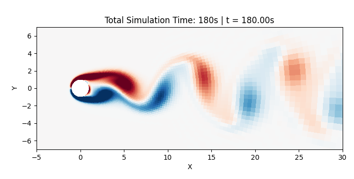

# Project: Numerical Simulation of the Kármán Vortex Street

## 1. Project Description
This project deals with the numerical simulation and visualization of the **Kármán vortex street**. This is a characteristic phenomenon in fluid mechanics in which vortices are shed periodically behind a body placed in a flow.

The implementation is done entirely in **Python**. To capture the physical conditions with high numerical resolution, the computational grid is formulated in **logarithmic polar coordinates**.



*Vorticity field of the simulated Kármán vortex street at t = 180.*

## 2. Simulation Parameters

* **Reynolds number ($Re$):** `100` to `150` (characterizes the flow regime)
* **Grid resolution ($N_\xi \times N_\theta$):** `160x160`, `256x256` (number of grid points in the radial and tangential directions [$N_\xi$ = n, $N_\theta$ = m])
* **Time step ($\Delta t$):** `Δt = 0.033` for `m = n = 160`, `Δt = 0.012` for `m = n = 256` (discretization of the time axis)
* **Simulation duration ($T_{\text{max}}$):** `180` (dimensionless time units)

The grid spacing follows from the θ-discretization as $h = 2\pi/(m-2)$ and is used in both directions, so the grid cells are square. This yields $\xi_{\text{max}} = (n-1)\,h$; for `n = m = 160` this corresponds to a computational domain radius of $e^{\xi_{\text{max}}} \approx 558$ cylinder radii.

The specified time steps are close to the stability limit of the explicit scheme. Larger values (e.g. `Δt = 0.038` for `n = m = 160`) cause the computation to diverge.

## 3. Algorithms and Numerical Methods

### 3.1 Solving the Poisson Equation (Stream Function)
To compute the stream function $\psi$ from the vorticity $\omega$, the Poisson equation $\nabla^2\psi = -\omega$ is solved at every time step:

- **Method:** Direct solution of the linear system $A\psi = b$. The system matrix $A$ is assembled as a sparse matrix and LU-factorized once, so that only forward and backward substitution are required per time step.
- **Discretization:** Second-order central differences, natural ordering $k = i + (j-1)n$.
- **Boundary conditions:**
  - Cylinder surface ($\xi = 0$): $\psi_{1,j} = 0$
  - Far field ($\xi = \xi_{\text{max}}$): $\psi_{n,j} = e^{\xi_n}\sin\theta_j$
  - θ-direction: periodic via two ghost points, $\psi_{i,1} = \psi_{i,m-1}$ and $\psi_{i,m} = \psi_{i,2}$

### 3.2 Time Stepping of the Vorticity Transport Equation
The temporal evolution of the vorticity field $\omega$ is modeled by the vorticity transport equation:

- **Time discretization:** Fourth-order Runge-Kutta method for the vorticity transport equation. The stream function is computed once per time step from the Poisson equation and held constant across all four RK stages (lagged ψ-ω coupling). As a result, the overall scheme is first-order accurate in time.
- **Diffusion term:** Second-order central differences
- **Convection term:** Second-order central differences
- **Vorticity boundary conditions:**
  - Cylinder surface: $\omega_{1,j} = (\psi_{3,j} - 8\psi_{2,j}) / 2h^2$
  - Far field: $\omega_{n,j} = 0$
  - θ-direction: periodic, analogous to the stream function

### 3.3 Initial Condition
The simulation starts with $\omega = 0$ plus a small perturbation

$$\omega_0 = 0.05 \cdot (\cos\theta + \sin\theta) \cdot e^{-2\xi}.$$

This breaks the symmetry about the x-axis and considerably accelerates the onset of the instability. For `Re = 100` and `n = m = 160`, the oscillation starts to grow at around $t \approx 40$ and is fully developed from about $t \approx 100$. Without the perturbation, the vortex street only forms at $t \approx 1100$, which would not be practical for the simulation duration chosen here.

## 4. Validation
For validation, the Strouhal number $St = f \cdot D / U$ is computed. To this end, the stream function at a fixed point in the wake ($r = 3$, $\theta = 0$) is recorded over time, and the shedding frequency $f$ is determined from the maximum of the amplitude spectrum (FFT) of the second half of the time signal. Because the equations are nondimensionalized with the cylinder radius and the free-stream velocity, $St = 2f$.

The empirical correlation by Roshko serves as the reference:

$$St = 0.198 \left(1 - \frac{19.7}{Re}\right)$$

The evaluation is carried out in the notebook `notebooks/strouhal_number.ipynb`.

### Results for Re = 100

| Simulation time | Time series | Re | Grid size | St (simulation) | St (Roshko) | Relative error |
|:---:|:---:|:---:|:---:|:---:|:---:|:---:|
| 180 | Stream function $\psi$ | 100 | 160 × 160 | 0.1556 | 0.1590 | 2.15 % |
| 180 | Stream function $\psi$ | 100 | 196 × 196 | 0.1556 | 0.1590 | 2.16 % |
| 180 | Stream function $\psi$ | 100 | 256 × 256 | 0.1556 | 0.1590 | 2.16 % |

## 5. Project Structure
```text
Numerik Projekt Karmansche Wirbelstrasse/
├── docs/
│   └── karman_vortex_street.png
├── notebooks/
│   ├── strouhal_number.ipynb
│   └── script_for_visualizing_vorticity_with_scale.py
├── src/
│   ├── grid.py
│   ├── simulation.py
│   └── solver.py
├── readme.md
└── main.py
```

## 6. Usage
The program can be run via `main.py`. The parameters can be adjusted there and the simulation started.

The simulation can also be started in the notebook `notebooks/strouhal_number.ipynb`, where the Strouhal number can be computed to validate the simulation.

## Dependencies
- **numpy**: vectorized computation and other mathematics
- **matplotlib**: visualization
- **scipy**: sparse matrices and solving linear systems

## 7. Background
The numerical formulation follows the lecture notes *Flow Around a Cylinder* by Jeffrey R. Chasnov (HKUST), in particular the chapters on logarithmic polar coordinates (Lecture 8) and on unsteady flow (Lectures 16–21).

## 8. Authors
Louis B., Linus D., Gustav H., Maximilian M.
